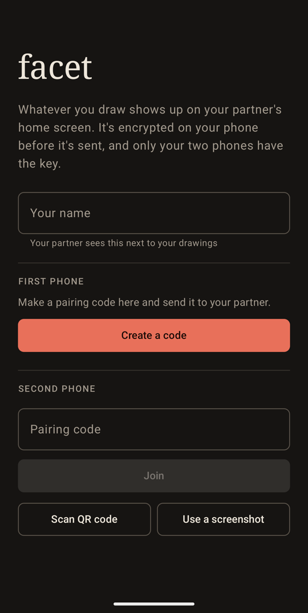
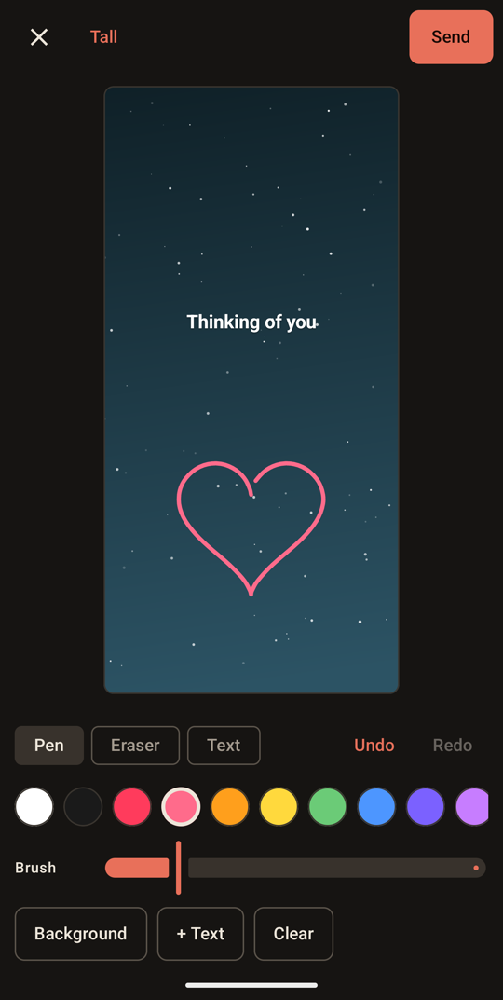
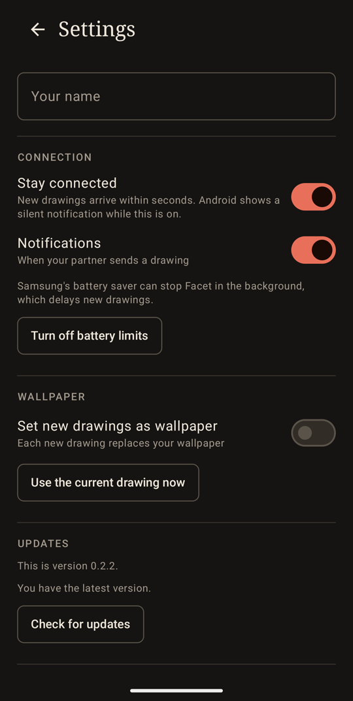

  

<h1 align="center">facet</h1>

  A shared drawing for two Android phones. What one of you draws appears on the other's home screen.

  
  
  

  
  &nbsp;
  
  &nbsp;
  

## What it does

- Draw with your finger, add text (English and Arabic quick phrases), or draw over a photo or one of the backgrounds.
- The drawing shows up on your partner's phone in the app, in a resizable home-screen widget, and, if they turn it on, as their wallpaper.
- A portrait photo or a "Tall" drawing is sized to the phone's screen, so it fills the wallpaper without borders.
- The app checks this page for new versions and installs them itself.

## Install

1. On each phone, download **`facet-*.apk`** from the [latest release](https://github.com/op-h/facet-releases/releases/latest) and open it. Android will ask you to allow installs from your browser or file manager.
2. On the first phone, tap **Create a code**, then **Send link** and send it to your partner in a private chat.
3. On the second phone, tap the link and then **Open in Facet**. Facet opens with the code filled in. If you're together, scanning the QR code works too.
4. Check that both phones show the same five symbols.

On Samsung phones, set Settings → Apps → Facet → Battery to **Unrestricted**. Otherwise One UI can stop Facet in the background and new drawings arrive late.

## Updates

When a new version is published here, Facet shows "Version x is available" on its main screen. Tap **Update now**. The first time, Android asks you to allow Facet to install apps; after that, an update takes one tap.

The app only installs an APK whose SHA-256 matches the one in `update.json`, and Android only accepts it if it is signed with the same key as the copy already on the phone.

## Privacy

Each pair shares a random 256-bit key, made on the first phone and passed on through the pairing code. Drawings are encrypted with AES-256-GCM on the phone before they are uploaded, so the server (Firebase Realtime Database) only stores data it can't read. The key is kept in the Android Keystore and is not included in backups. Only the latest drawing is stored; there is no history.

Anyone who has your pairing code can see and change your drawing, so share it only with your partner.

## Release files

| File | What it is |
|---|---|
| `facet-<n>.apk` | The app. `<n>` is the version code. |
| `update.json` | Version, notes, download link and SHA-256 that installed copies read to find updates. |

This repository holds releases only.
